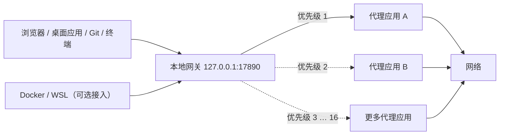

# Proxy Gateway · 本地代理网关

**给 Windows 应用一个固定代理入口，在多个本地代理客户端之间按优先级自动切换。**

[](https://github.com/AkparAby/proxy-gateway/releases/latest)
[](LICENSE)
[](https://github.com/AkparAby/proxy-gateway/releases/latest)

Proxy Gateway 使用 **Go 管理程序 + 独立 Mihomo 内核**，提供中文 Web 管理页。支持添加 1–16 个本机 HTTP / SOCKS5 代理出口，自定义名称并调整优先级。应用始终连接同一地址，网关负责检测出口、故障切换和恢复回切。

[下载 Windows 便携版](https://github.com/AkparAby/proxy-gateway/releases/latest) · [报告问题](https://github.com/AkparAby/proxy-gateway/issues) · [许可证说明](THIRD_PARTY_NOTICES.md)

## 能做什么

- **统一入口**：HTTP、HTTPS CONNECT 和 SOCKS5 共用 `127.0.0.1:17890`。
- **多个代理出口**：添加、删除、改名和上下调整优先级，可连接不同软件提供的本机 HTTP / SOCKS5 端口。
- **自动故障切换**：通过每个出口实际访问 HTTPS 地址，连续失败后按优先级选择健康备用，减少偶发波动导致的切换。
- **可选回切策略**：更高优先级出口稳定恢复后自动切回，或保持当前出口、手动切回首选；也支持固定任一出口。
- **按需接入**：分别启用 Windows 系统代理、终端环境变量、Git HTTPS、Docker Desktop、WSL Ubuntu。
- **便携运行**：Release 包含 EXE、内核和必要脚本，无需安装 Go、Node.js 或 Python。
- **可恢复设置**：接入功能保存原值；可逐项停用恢复，或恢复后停止网关。可选当前用户登录自启动。

这是主备故障切换工具，目前不做流量轮询、带宽叠加或已有连接的无缝迁移。

## 工作方式



网关本身不提供代理节点、账号或订阅。各个出口客户端需要分别安装、配置并保持连接；它们各自的节点选择和分流规则仍然生效。

## 快速开始

### 1. 下载并解压

在 [Releases](https://github.com/AkparAby/proxy-gateway/releases/latest) 下载 `proxy-gateway-vX.Y.Z-windows-amd64.zip`，**完整解压**到当前用户可写的固定目录，例如 `D:\Apps\ProxyGateway`。不要直接在压缩包内运行，也不要只复制 EXE。

- 运行环境：Windows 10/11 x64、系统自带 Windows PowerShell 5.1 或 PowerShell 7。
- 暂不提供 Windows ARM64、Linux 或 macOS 版本。
- 首次运行没有已启用的接入项或自启动设置；配置会在本机生成。

### 2. 准备代理客户端

选择能提供本机 **HTTP 或 SOCKS5 代理端口**的客户端，分别确认它们已连接且能正常代理上网。不同客户端应使用不同端口，并关闭客户端的系统代理、代理守护和 TUN，让网关统一管理应用接入。

首次启动提供两个可编辑的示例出口：

| 名称 | 协议 | 本机地址 | 端口 |
|---|---|---|---|
| 代理 1 | HTTP | `127.0.0.1` | `17891` |
| 代理 2 | HTTP | `127.0.0.1` | `7892` |

这些名称和端口不绑定任何软件。你可以重命名、修改协议和端口，删除不需要的出口，或点击“添加代理应用”增加更多。支持 1–16 个出口，所有出口均需使用本机回环 IP（例如 `127.0.0.1`、`::1`），上游暂不支持账号密码认证。

网关不会替你启动或连接客户端。例如使用 SpeedCat 时仍需处于“已连接”状态，使用其他客户端时也需要保持其代理服务运行。客户端上游不能指回网关的 `17880`、`17881` 或 `17890`，否则会形成循环。

### 3. 启动网关

双击 **`proxy-gateway.exe`**，它会启动网关并自动打开默认浏览器中的管理页。`Start-Gateway.cmd` 也可使用：

- 管理页：<http://127.0.0.1:17880>
- 统一代理：`127.0.0.1:17890`

也可以在解压目录执行：

```powershell
powershell.exe -NoProfile -ExecutionPolicy Bypass -File .\Start-Gateway.ps1 -OpenDashboard
```

网关已运行时再次双击 EXE，会打开现有管理页，不会重复启动内核。EXE 内嵌多尺寸网关图标，无需额外放置图标文件。关闭管理页不会停止网关。

需要静默启动时使用：

```powershell
.\proxy-gateway.exe --background
```

### 4. 添加出口、调整优先级并接入应用

在“代理出口与切换策略”中设置各客户端的名称、协议、地址和端口。使用“上移 / 下移”调整优先级，**列表第一个是首选出口**。点击“保存出口与策略”后重新检测，并按新配置选择出口。删除固定模式使用的出口时，界面会将模式改为自动，保存后生效。

等管理页显示出口可用后，在“应用接入”中启用需要的项目；也可在应用自己的代理选项中手动填写：

```text
HTTP / HTTPS 代理：http://127.0.0.1:17890
SOCKS5 代理：socks5h://127.0.0.1:17890
```

`HTTPS_PROXY` 使用 `http://` 是正常的：HTTPS 目标通过 HTTP CONNECT 建立隧道。部分应用的 SOCKS5 输入框需要分别填写主机、端口和“代理解析 DNS”。

### 5. 可选：登录自启动

在管理页启用“登录后启动网关”，之后当前 Windows 用户登录时在后台自动启动，不弹出浏览器。各出口客户端的自启动和自动连接需要分别设置。启用后请保留解压目录的路径；移动目录前先停用自启动，再在新目录重新启用。

## 默认策略与边界

| 项目 | 默认值 / 行为 |
|---|---|
| 出口优先级 | 列表从上到下；第一个为首选，其余为备用 |
| 检测间隔 | 每轮检测完成后等待 10 秒 |
| 单个请求超时 | 3 秒 |
| 故障阈值 | 已知健康出口连续失败 3 轮 |
| 恢复回切 | 优先级更高的出口连续健康 60 秒后自动回切 |
| 检测目标 | `https://www.gstatic.com/generate_204`、`https://cp.cloudflare.com/generate_204`；任一返回 2xx 即成功 |
| 所有出口都不可用 | 拒绝需要代理的请求，不自动改为直连 |
| 直连规则 | 本机、私有 IP，以及配置的域名后缀；默认域名仅 `localhost`、`local` |

首次启动时，出口需要检测成功后才会被采用。当前出口故障时按优先级寻找健康出口，可以连续跳过多个故障出口。启用自动回切时，会在更高优先级的出口中选择已满足稳定时间的最高优先级出口；保持模式则继续使用当前健康出口，直到它故障或手动切回首选。故障判定时间包含检测耗时，并非固定 30 秒。检测地址应能代表你的实际使用需求，也可在管理页替换。

切换影响**新建连接**。已经建立的下载、上传、WebSocket、SSH 和流式请求可能中断，需要应用自行重连；网关不会自动重放业务请求。固定出口模式只使用指定出口，不使用其他出口兜底。

当前面向 TCP 代理，不支持通过网关转发 UDP / QUIC，也不提供全机 TUN 或任意进程的强制代理。

## 各类应用如何接入

| 接入项 | 修改范围 | 生效条件 / 限制 |
|---|---|---|
| Windows 系统代理 | 当前用户的 Windows 系统代理 | 适用于遵循系统代理的浏览器和桌面应用；不是所有应用都会使用它 |
| 终端与子进程 | 用户级 `HTTP_PROXY`、`HTTPS_PROXY`、`ALL_PROXY`、`NO_PROXY` | 重新打开终端或应用，且程序本身支持这些变量 |
| Git HTTPS | 当前用户 Git 的 `http.proxy` | HTTP(S) 仓库生效；Git SSH 需自行配置 |
| Docker Desktop | Docker CLI 的 `proxies.default` 及 Desktop 代理模式 | 需要已安装并初始化 Docker Desktop，同时启用网关的系统代理接入；修改后重启 Desktop |
| WSL Ubuntu | Ubuntu 的 shell 环境文件与加载行 | 面向名为 `Ubuntu` 的发行版和 NAT 网络；新 shell 生效 |

浏览器或 Codex 等桌面应用是否走网关，还取决于应用自己的代理选项和环境。系统代理不是“所有没有独立配置的应用一定使用”的强制路由机制。

**Docker：** 新构建和新建容器使用 `host.docker.internal:17890`；已运行容器不自动更新，容器内程序也要支持代理环境变量。网关不会自动重启 Docker Desktop。自定义网络、构建器或 Linux Docker Engine 需要另行验证。

**WSL：** 启用后通过默认路由寻找 Windows 主机，并在 WSL 虚拟网卡建立受子网限制的转发入口；不绑定物理网卡。镜像网络和其他发行版不在当前接入脚本的支持范围内。现有 Ubuntu shell 可执行：

```sh
. ~/.config/local-proxy-gateway/env.sh
```

## 文件、停止与升级

便携包包含：

```text
proxy-gateway-vX.Y.Z-windows-amd64/
├── proxy-gateway.exe           # Go 管理程序，内嵌管理页
├── Start-Gateway.cmd / .ps1    # 启动入口
├── Restore-Proxy.cmd / .ps1    # 应急恢复接入设置
├── scripts/                   # Windows / WSL 接入脚本
├── runtime/mihomo.exe          # 校验过的官方 Mihomo 内核
├── licenses/                  # 第三方许可证
├── release-manifest.json       # 版本、源码提交、依赖来源和文件哈希
├── README.md
├── LICENSE
└── THIRD_PARTY_NOTICES.md
```

运行后才会生成 `config.json`、`runtime/*.json`、日志和内核缓存。Release **不包含发布者的本机配置、日志、状态、备份、订阅或凭据**。需要核对下载完整性时，可将以下结果与 Release 附带的 `SHA256SUMS.txt` 比较：

```powershell
Get-FileHash .\proxy-gateway-vX.Y.Z-windows-amd64.zip -Algorithm SHA256
```

- **正常停止：** 在管理页点击“恢复接入设置并停止”。这也会撤销网关管理的登录自启动；下次需要时重新启用。
- **应急恢复：** 管理页无法打开时，双击 `Restore-Proxy.cmd`。它恢复此前由此目录中的网关接管的设置，本身不终止进程。恢复需要保留 `runtime/integrations-state.json`，不要提前删除运行目录。
- **升级：** 在旧版管理页恢复接入设置并停止 → 备份自己的 `config.json` → 将新版解压到新目录 → 复制自己的 `config.json` 到新目录 → 启动并重新启用所需接入项。不要复制旧版的日志、内核临时配置或接入状态到新包。

从 v0.1.x 升级时，程序会自动将原有 SpeedCat / Clash 配置迁移为可编辑的出口列表，保留端口、协议、主出口顺序、固定模式和检测策略，并将原始配置备份到本机 `backups/config-v1-*.json`。备份不进入 Release。迁移后的配置不能直接给旧版读取；回退时请恢复旧配置备份。

恢复只涉及网关管理的配置项，不会替你恢复各代理客户端的端口或 TUN 设置。关闭或卸载前应先恢复接入，避免应用继续指向已停止的网关。

## 常见问题

**启动后没有窗口？**

管理程序没有独立桌面窗口，界面在默认浏览器里。双击 EXE 或 `Start-Gateway.cmd` 会自动打开管理页；登录自启动和 `--background` 模式不弹浏览器。也可手动访问 <http://127.0.0.1:17880>。

**启动失败或管理页打不开？**

确认完整解压且目录可写，检查 `17880`、`17881`、`17890` 是否被其他程序占用。查看 `runtime/gateway.log` 和 `runtime/mihomo.log`；文件缺失时重新解压完整包。一个 Windows 实例只运行一套网关。

**所有出口都显示不可用？**

先分别验证客户端已连接、本地端口与网关设置一致；关闭客户端的系统代理、代理守护和 TUN，再检查 HTTPS 检测地址是否可达。只打开客户端窗口不代表代理已连接。

**开启系统代理后有些应用仍不走网关？**

检查应用是否遵循 Windows 系统代理、是否另有代理设置，或改用终端环境变量和应用自带的代理选项。已有进程可能仍保留旧环境，需要重新启动。

**内核退出后会自动恢复吗？**

管理程序会重启异常退出的 Mihomo，重新检测出口后恢复转发。整个管理程序若异常退出，需要重新启动；“登录自启动”不等于持续的系统服务监控。

## 开发与打包

开发需要 **Windows、Go 1.26+、Git 和 PowerShell 7**。管理页使用原生 HTML/CSS/JavaScript，无前端构建依赖。

```powershell
git clone https://github.com/AkparAby/proxy-gateway.git
cd proxy-gateway
go test ./...
go vet ./...
pwsh -NoProfile -File .\scripts\package-release.ps1 -Version v0.2.1
```

打包脚本要求 Git 工作区干净，输出到 `dist/<版本>/`。它按 `scripts/mihomo.lock.json` 下载固定版本内核和对应源码，校验 SHA-256，构建 Windows x64 EXE，再按文件白名单生成 ZIP、源码附件和 `SHA256SUMS.txt`。已存在的版本目录不会被覆盖。

在解压的开发包中运行。修改 Go 或 `web/` 后，可重新构建并替换已停止的管理程序：

```powershell
go build -trimpath -ldflags '-H=windowsgui' -o proxy-gateway.exe .
```

Windows 图标资源 `rsrc_windows_amd64.syso` 已包含在源码仓库中，普通 `go build` 会自动嵌入；更换图标时参见 [图标源文件与生成说明](winres/README.md)。

源码仓库不附带内核。若直接运行源码构建的 EXE，需将打包结果中的 `runtime/mihomo.exe` 复制到项目的同名位置，并保持启动与接入脚本完整。

单元测试覆盖多出口故障切换、优先级恢复、保持当前出口、固定模式、删除出口、旧配置迁移、回环配置和管理接口校验。`scripts/verify-failover.mjs` 可进一步演练真实主备切换；它需要 Node.js、至少两个健康出口及运行中的网关，会暂时修改策略并可能中断连接，仅适合在可中断的测试环境执行。

## 贡献与许可证

欢迎提交 [Issue](https://github.com/AkparAby/proxy-gateway/issues) 或 Pull Request。报告问题时请提供版本、Windows 版本、复现步骤和脱敏日志，不要提交订阅、令牌、账号信息、`config.json` 或完整 `runtime/` 目录。

项目管理程序、页面和脚本采用 [MIT License](LICENSE)。便携包中的独立 [Mihomo](https://github.com/MetaCubeX/mihomo) 内核采用 GPL-3.0，保留其原许可证，并在同一 Release 提供对应版本的源码附件；MIT 许可证不替代第三方许可证。详见 [THIRD_PARTY_NOTICES.md](THIRD_PARTY_NOTICES.md)。
