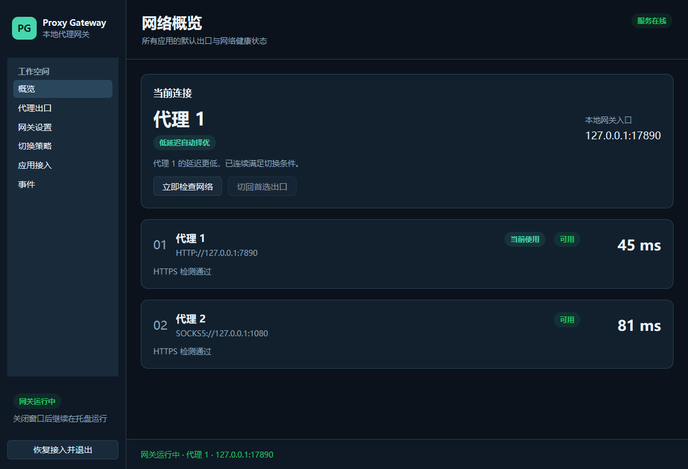
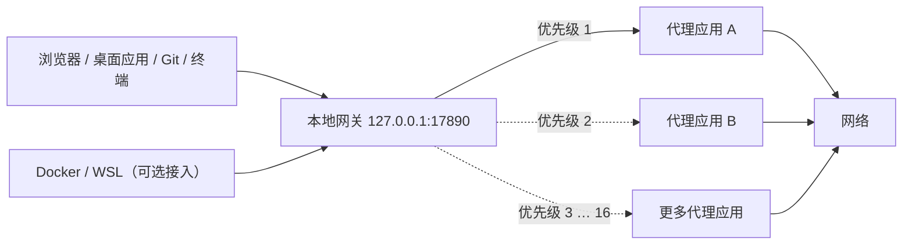

# Proxy Gateway · 本地代理网关

**给 Windows 和 macOS 应用一个固定代理入口，按延迟或优先级自动选路，也可为 Codex、Claude 单独固定代理客户端。**

[](https://github.com/AkparAby/proxy-gateway/releases/latest)
[](LICENSE)
[](https://github.com/AkparAby/proxy-gateway/releases/latest)
[](https://github.com/AkparAby/proxy-gateway/releases/latest)

Proxy Gateway 使用 **MyGo 原生桌面界面、独立 Go 管理程序和 Mihomo 内核**。Windows 和 macOS 使用同一套左侧导航界面，支持托盘 / 菜单栏常驻，浏览器管理页作为备用入口保留。可添加 1–16 个本机 HTTP / SOCKS5 代理出口；网关负责健康检测、低延迟择优、故障切换和应用固定路由。

[下载 Windows / macOS 版](https://github.com/AkparAby/proxy-gateway/releases/latest) · [报告问题](https://github.com/AkparAby/proxy-gateway/issues) · [许可证说明](THIRD_PARTY_NOTICES.md)

## 能做什么

- **统一入口**：HTTP、HTTPS CONNECT 和 SOCKS5 默认共用 `127.0.0.1:17890`，可在“网关设置”中自定义端口。
- **多个代理出口**：添加、删除、改名和上下调整优先级，可连接不同软件提供的本机 HTTP / SOCKS5 端口。
- **自动故障切换**：通过每个出口实际访问 HTTPS 地址，连续失败后按优先级选择健康备用，减少偶发波动导致的切换。
- **可选回切策略**：更高优先级出口稳定恢复后自动切回，或保持当前出口、手动切回首选；也支持固定任一出口。
- **低延迟自动择优**：可开启“自动切换最优网络”，按平滑 HTTPS 检测延迟选出口，支持连续观察轮数、最小改善幅度和切换冷却。
- **应用固定代理**：选择自动识别的 Codex、Claude 等应用，再指定代理客户端即可绑定，常规操作无需填写 HTTP 或手找路径；默认出口切换不影响固定规则。
- **按需接入**：Windows 支持系统代理、终端、Git、Docker 和 WSL；macOS 支持系统代理、Git 和登录自启动。
- **左侧导航**：概览、代理出口、网关设置、切换策略、应用接入和事件六个页面；内容独立滚动，保存按钮固定在顶部，底栏只显示网关状态。中文字体内嵌，无需浏览器或 WebView2。
- **检测反馈**：自动检测静默刷新延迟；手动点击“立即检查网络”才显示逐个出口的转圈动画，完成后分别显示结果。失败检测地址不计入平均延迟。
- **托盘运行**：关闭窗口继续代理，再次打开唤起已有窗口；从菜单明确恢复接入后退出。
- **安装即用**：Windows 提供 Setup.exe；macOS Apple 芯片版主推 PKG，另提供 DMG 和 ZIP。均附带内核，无需安装 Go、Node.js 或 Python。
- **可恢复设置**：接入功能保存原值；可逐项停用恢复，或恢复后停止网关。可选当前用户登录自启动。

目前不做流量轮询、带宽叠加或已有连接的无缝迁移。



### v0.5.1 更新

- 修复 macOS 未识别 Codex 桌面版和 CLI：按应用标识识别桌面版，兼容保留同一标识的 `ChatGPT.app`、改名或移动后的应用、运行中的临时挂载应用。
- 支持直接下载的 `codex` / `codex-aarch64-apple-darwin` / `codex-x86_64-apple-darwin`，以及 Homebrew、npm / nvm 和常见用户目录中的原生 CLI；从 Finder 启动也可发现。
- 自动解析符号链接并识别桌面辅助进程；扫描不执行 CLI、Shell 配置或安装脚本，不把共享 Node / Python 进程绑定为某个应用。

### v0.5.0 更新

- Windows 和 Apple 芯片 Mac 安装包统一使用 MyGo 新界面，改善滚动和网关启停状态提示，统一窗口与托盘图标。
- 增加可开关的低延迟自动择优，以及 Codex / Claude 的自动识别和固定代理客户端配置。
- 手动检查显示动画，自动检查保留已有延迟；多个检测地址只对成功结果取平均，全部失败仍视为本轮检测失败。
- 沿用原有配置格式和恢复机制，升级步骤见下方升级与迁移说明。

## 工作方式



网关本身不提供代理节点、账号或订阅。各个出口客户端需要分别安装、配置并保持连接；它们各自的节点选择和分流规则仍然生效。

## 快速开始

### 1. 下载安装

在 [Releases](https://github.com/AkparAby/proxy-gateway/releases/latest) 选择对应平台的安装包：

| 平台 | 下载文件 | 要求 |
|---|---|---|
| Windows x64（推荐） | `proxy-gateway-vX.Y.Z-windows-amd64-setup.exe` | Windows 10/11，系统自带 Windows PowerShell 5.1 |
| macOS Apple 芯片（推荐） | `proxy-gateway-vX.Y.Z-macos-arm64.pkg` | Apple Silicon（M 系列），macOS 12 或更新版本 |
| macOS 拖拽安装 | `proxy-gateway-vX.Y.Z-macos-arm64.dmg` | 打开后将应用拖到旁边的 Applications 文件夹 |
| Windows / macOS 便携包 | 对应平台的 `.zip` | 完整解压后运行；适合手动管理版本 |

**Windows：** 双击 Setup.exe，默认安装到 `%LOCALAPPDATA%\Programs\Proxy Gateway`，无需管理员权限。安装程序创建开始菜单入口，可选桌面快捷方式，并登记到“设置 → 应用 → 已安装的应用”。安装完成后从开始菜单启动。便携包应完整解压到用户可写的固定目录，例如 `D:\Apps\ProxyGateway`，不要在压缩包内运行或只复制 EXE。

**macOS：** 双击 PKG，按向导将 **Proxy Gateway.app** 安装到 `/Applications`（可能需要管理员密码），然后从“应用程序”中打开。偏好拖拽安装时使用 DMG；ZIP 同样可以解压后手动复制 `.app`。只提供 Apple 芯片版，不提供 Intel 版。

**首次打开与签名：** Windows 安装包暂未做 Authenticode 签名。Mac 应用只有本地 ad-hoc 签名，**PKG 未签名，应用和安装包均未做 Apple 公证**；安装包格式不会消除系统的来源验证提示。若安装器或应用被阻止，确认来源为本仓库 Release 并核对校验和，再按 [Apple 官方说明](https://support.apple.com/en-us/102445) 到“系统设置 → 隐私与安全 → 仍要打开”允许这个文件。不要关闭整个系统的 Gatekeeper。Mac 原生窗口目前仍待实体 Mac 验证，详见下方开发与打包说明。

首次运行会在本机生成默认配置，所有接入项和登录自启动默认关闭。网关不会自动接管系统代理。

### 2. 准备代理客户端

选择能提供本机 **HTTP 或 SOCKS5 代理端口**的客户端，分别确认它们已连接且能正常代理上网。不同客户端应使用不同端口，并关闭客户端的系统代理、代理守护和 TUN，让网关统一管理应用接入。

首次启动提供两个可编辑的示例出口：

| 名称 | 协议 | 本机地址 | 端口 |
|---|---|---|---|
| 代理 1 | HTTP | `127.0.0.1` | `17891` |
| 代理 2 | HTTP | `127.0.0.1` | `7892` |

这些名称和端口不绑定任何软件。你可以重命名、修改协议和端口，删除不需要的出口，或点击“添加代理应用”增加更多。支持 1–16 个出口，所有出口均需使用本机回环 IP（例如 `127.0.0.1`、`::1`），上游暂不支持账号密码认证。

网关不会替你启动或连接客户端。例如使用 SpeedCat 时仍需处于“已连接”状态，使用其他客户端时也需要保持其代理服务运行。客户端上游不能指回管理端口 `17880`、`17881`、`17882` 或当前网关监听端口（默认 `17890`），否则会形成循环。

### 3. 启动网关

Windows 从开始菜单打开 **Proxy Gateway**，或双击目录中的 **`proxy-gateway.exe`**（也可使用 `Start-Gateway.cmd`）；macOS 双击 **`Proxy Gateway.app`**。程序启动后直接显示 MyGo 桌面管理窗口：

- 桌面管理：双击程序，或点击托盘 / Mac 菜单栏中的网关图标。
- 备用浏览器管理页：<http://127.0.0.1:17880>
- 统一代理：默认 `127.0.0.1:17890`，当前地址显示在窗口顶部。

网关在线时显示“服务在线 / 网关运行中”，只有离线时才显示“启动网关”。点击“立即检查网络”后，每个代理的延迟位置显示动画，收到各自结果后恢复数字或显示“检测失败”。定时检查不会显示动画；底部状态栏始终显示网关状态。

Windows 也可以在解压目录执行：

```powershell
powershell.exe -NoProfile -ExecutionPolicy Bypass -File .\Start-Gateway.ps1 -OpenDashboard
```

再次双击 EXE 或 `.app`，会唤起已有桌面窗口，不重复启动界面和内核。两种版本都内嵌网关图标。Windows 使用系统托盘，macOS 使用顶部菜单栏图标。**窗口的 × 只隐藏界面，代理继续工作。** 真正退出请使用窗口或托盘菜单的“恢复接入并退出”；恢复失败时会保留客户端并显示原因。

需要静默启动时使用：

```powershell
.\proxy-gateway.exe --background
```

macOS 在终端静默启动（应用放在默认安装位置时）：

```sh
"/Applications/Proxy Gateway.app/Contents/MacOS/ProxyGateway" --background
```

### 自定义网关端口

在“网关设置 → 监听端口”填写 **1024–65535** 内的端口，然后点击“保存全部设置”。HTTP、HTTPS CONNECT 和 SOCKS5 共用该端口；只监听本机回环地址。管理端口 `17880 / 17881 / 17882` 保持固定，监听端口不能与它们或任一代理出口冲突。

保存前检查 TCP / UDP 端口占用，保存后重新监听，并同步**已启用**的接入：Windows 系统代理、用户环境变量、Git、Docker 配置和 WSL；macOS 系统代理、Git。保留原始恢复记录与登录自启动设置。应用失败时尝试回退原端口与接入配置，并报告回退结果。

更换端口时现有连接可能中断；已打开的终端、应用需重开，已创建的容器需重建。应用中手动填写的代理地址需自行更新。macOS 修改系统代理会请求管理员授权。以下示例使用默认 `17890`，自定义后请替换为实际端口。

### 4. 添加出口、调整优先级并接入应用

在桌面的“代理出口”页设置各客户端的名称、协议、地址和端口，在“切换策略”页设置自动回切、固定出口和检测参数。使用“上移 / 下移”调整优先级，**列表第一个是首选出口**。点击“保存全部设置”后重新检测，并按新配置选择出口。删除固定模式使用的出口时，界面会将模式改为自动，保存后生效。

等管理页显示出口可用后，在“应用接入”中启用需要的项目；也可在应用自己的代理选项中手动填写：

```text
HTTP / HTTPS 代理：http://127.0.0.1:17890
SOCKS5 代理：socks5h://127.0.0.1:17890
```

`HTTPS_PROXY` 使用 `http://` 是正常的：HTTPS 目标通过 HTTP CONNECT 建立隧道。部分应用的 SOCKS5 输入框需要分别填写主机、端口和“代理解析 DNS”。

### 5. 可选：登录自启动

在“应用接入”中启用“登录后启动网关”，之后当前系统用户登录时在后台自动启动并显示托盘图标，不弹出管理窗口。各出口客户端的自启动和自动连接需要分别设置。Windows 使用当前用户的登录启动项；macOS 使用用户级 LaunchAgent，下次登录时生效。启用后请保留程序路径；移动目录或应用前先停用自启动，再在新位置重新启用。macOS 如提示后台项目被禁用，请在系统的登录项设置中允许 Proxy Gateway。

## 默认策略与边界

### 自动切换最优网络

在桌面“切换策略”或 Web 设置中开启“自动切换最优网络（低延迟）”，点击“保存全部设置”。旧配置及首次启动默认关闭，沿用原有优先级故障切换。

- 自动模式下开启：比较健康出口最近 3 轮的平滑延迟。默认候选连续 3 轮至少快 20ms，且距上次切换至少 30 秒才切换；这些参数可调整。相同延迟保持当前出口。
- 所有出口检测相同的 HTTPS 地址，等待各目标结果后，仅对成功目标取平均延迟；失败或超时目标不计入平均值。任一目标成功即视为本轮健康，全部失败则本轮检测失败。整轮检测失败、未检测和过期的数据不参与择优。
- 例如两个地址测得 `100 ms` 和超时，本轮延迟为 `100 ms`；两个都成功且分别为 `100 ms`、`300 ms` 时，本轮为 `200 ms`。界面展示最近 3 轮的平滑值，因此不会总等于单次测量。
- 当前出口连续失败达到故障阈值时，跳过择优观察和冷却，选择检测有效的最低延迟健康出口。全部不可用时拒绝代理请求。
- 开启择优会暂停“稳定后按优先级回切”和“切回首选”；手动固定默认出口时暂停择优。关闭择优恢复原优先级策略。
- 日常择优只更新默认出口选择，不重新加载内核配置、不主动关闭已有连接；新连接采用新出口。延迟分数代表配置的检测目标，不代表所有网站速度或带宽。

### 为 Codex、Claude 等应用固定客户端

在桌面“应用接入 → 选择应用”（或“绑定 Codex / Claude”）选择已安装的应用和代理客户端，点击“添加到设置”，再点击“保存全部设置”。Web 页提供同样的应用选择。**常规操作不需要填写 HTTP 地址或查找程序路径。**

网关会在运行它的电脑上读取安装信息、常见安装目录、命令行入口和正在运行的程序，分别识别 Codex 桌面版、Codex CLI、Claude 桌面版、Claude Code CLI。Windows 支持微软商店应用、常见用户安装、npm 原生 CLI 和 `.local/bin` 原生 CLI。macOS 按 Bundle ID 识别 Applications 中的桌面应用，并通过 Spotlight 和运行进程补充非标准位置；同一 Codex 应用改名为 `ChatGPT.app` 后也可识别。CLI 支持 Homebrew、npm / nvm、常见 `bin` 目录和 Downloads 中的独立可执行文件，包括带 `apple-darwin` 架构后缀的 Codex。任意便携目录可先打开应用或运行 CLI，再刷新列表。扫描不会执行 CLI 或 Shell 配置，共享 Node / Python 等运行时及纯脚本不会被当作独立原生应用绑定。

**macOS CLI 接入边界：** 识别到 CLI 表示已找到它的真实程序路径，不代表终端流量已进入网关。当前 macOS 版没有自动设置终端代理环境；CLI 仍需已通过代理环境或自己的代理配置接入网关，固定规则才会命中。桌面版的系统代理接入保持自动设置。

自动绑定保存应用身份，保存设置及网关启动时重新识别本机的实际程序，覆盖旧电脑或旧版本的路径。无法识别时显示“未检测到”，不会把绑定显示成已生效。“刷新应用列表”可重新扫描，保存规则时应用最新结果。

保存自动绑定会启用所需的系统代理接入；Windows 还会自动启用用户级终端代理环境，覆盖桌面联网辅助程序及原生 CLI。现有接入原值会保存，正常退出时恢复；已启用的接入不会重复备份。其他使用这些接入的程序跟随默认策略。**已运行的应用或终端可能需要重启一次以读取新设置。**此功能自动完成代理接入配置，仍不是 TUN 强制截流；应用显式覆盖代理设置、WSL/容器中的程序或不遵循代理的流量不能假定已绑定。

界面区分“尚未识别”“尚未完成接入”“接入已设置，等待新连接”和“已命中固定代理”。只有观察到实际连接命中时才显示已命中。未安装的应用不能作为新的启用绑定保存，已卸载应用的旧规则可以停用或删除。

原有手工方式保留在“高级规则”中，适用于其他程序或特殊接入需求：

| 接入方式 | 设置方法 | 适用边界 |
|---|---|---|
| 完整程序路径 | 选择或填写实际联网程序的完整路径，每行一个；一个规则支持最多 16 个路径 | 应用流量须先进入网关，路径匹配由内核完成；桌面、CLI、辅助进程可能使用不同路径，应用更新后路径也可能变化 |
| 专属代理入口 | 设置独立端口（例如 `17900`），保存后将 `http://127.0.0.1:17900` 或 `socks5h://127.0.0.1:17900` 配置到应用 | 支持独立代理配置的程序可直接使用；共享 Node 等运行时或难以识别的进程优先选此方式。不会修改全局环境变量 |

固定规则优先于默认自动/手动策略，绑定稳定的出口 ID，出口改名或排序不影响绑定。每个专属入口只监听本机回环地址，HTTP、HTTPS CONNECT 和 SOCKS5 共用端口。本机、局域网及 Tailscale 私有目标保留直连，其他固定应用流量使用指定客户端；自定义直连域名不覆盖固定规则。

固定客户端不可用时不会自动使用其他客户端或直连。固定的是客户端，不是该客户端内部的节点或公网 IP。全局默认出口不可用也不会阻断另一个仍能连接的固定客户端。

最多配置 32 条应用规则。关闭固定规则后，进程流量恢复普通规则匹配；专属入口地址保留并恢复普通规则匹配。删除规则会移除专属入口，需要先修改应用里的代理地址。被规则引用的出口（包括停用的规则）不能直接删除，须先修改或删除绑定。保存时检查入口端口冲突，内核应用失败会尝试回退配置。

界面显示已保存规则的出口健康状态、当前命中的活动连接数及实际出口。短请求可能在刷新前就结束，暂无活动连接不代表没有生效。建议在应用发起较长请求时核对状态。程序路径只识别已经进入网关的流量，不会强制接管绕过代理的程序；WSL、容器和其他转发入口不能依赖宿主机程序路径识别。

### 原有优先级策略

| 项目 | 默认值 / 行为 |
|---|---|
| 出口优先级 | 列表从上到下；第一个为首选，其余为备用 |
| 检测间隔 | 每轮检测完成后等待 10 秒 |
| 单个请求超时 | 3 秒 |
| 故障阈值 | 已知健康出口连续失败 3 轮 |
| 恢复回切 | 优先级更高的出口连续健康 60 秒后自动回切 |
| 检测目标 | `https://www.gstatic.com/generate_204`、`https://cp.cloudflare.com/generate_204`；任一返回 2xx 即成功 |
| 所有出口都不可用 | 拒绝需要代理的请求，不自动改为直连 |
| 直连规则 | 本机、私有 IP，以及配置的域名后缀；默认域名仅 `localhost`、`local` |

首次启动时，出口需要检测成功后才会被采用。当前出口故障时按优先级寻找健康出口，可以连续跳过多个故障出口。启用自动回切时，会在更高优先级的出口中选择已满足稳定时间的最高优先级出口；保持模式则继续使用当前健康出口，直到它故障或手动切回首选。故障判定时间包含检测耗时，并非固定 30 秒。检测地址应能代表你的实际使用需求，也可在管理页替换。

切换影响**新建连接**。已经建立的下载、上传、WebSocket、SSH 和流式请求可能中断，需要应用自行重连；网关不会自动重放业务请求。固定出口模式只使用指定出口，不使用其他出口兜底。

当前面向 TCP 代理，不支持通过网关转发 UDP / QUIC，也不提供全机 TUN 或任意进程的强制代理。

## 各类应用如何接入

| 接入项 | 修改范围 | 生效条件 / 限制 |
|---|---|---|
| Windows 系统代理（Windows） | 当前用户的 Windows 系统代理 | 适用于遵循系统代理的浏览器和桌面应用；不是所有应用都会使用它 |
| 终端与子进程（Windows） | 用户级 `HTTP_PROXY`、`HTTPS_PROXY`、`ALL_PROXY`、`NO_PROXY` | 重新打开终端或应用，且程序本身支持这些变量 |
| macOS 系统代理（macOS） | 当前启用网络服务的 HTTP / HTTPS / SOCKS 代理，以及 PAC / 自动发现开关 | macOS 会请求管理员授权；绕过列表和 PAC 地址保持原值。新增网络服务需停用再启用；带认证的原代理请手动接入 |
| Git HTTPS | 当前用户 Git 的 `http.proxy` | HTTP(S) 仓库生效；Git SSH 需自行配置 |
| Docker Desktop（Windows 按钮） | Docker CLI 的 `proxies.default` 及 Desktop 代理模式 | 需要已安装并初始化 Docker Desktop，同时启用网关的系统代理接入；修改后重启 Desktop |
| WSL Ubuntu（仅 Windows） | Ubuntu 的 shell 环境文件与加载行 | 面向名为 `Ubuntu` 的发行版和 NAT 网络；新 shell 生效 |

浏览器或 Codex 等桌面应用是否走网关，还取决于应用自己的代理选项和环境。系统代理不是“所有没有独立配置的应用一定使用”的强制路由机制。

**Windows Docker 按钮：** 新构建和新建容器使用 `host.docker.internal:17890`；已运行容器不自动更新，容器内程序也要支持代理环境变量。网关不会自动重启 Docker Desktop。自定义网络、构建器或 Linux Docker Engine 需要另行验证。

**Windows WSL：** 启用后通过默认路由寻找 Windows 主机，并在 WSL 虚拟网卡建立受子网限制的转发入口；不绑定物理网卡。镜像网络和其他发行版不在当前接入脚本的支持范围内。现有 Ubuntu shell 可执行：

```sh
. ~/.config/local-proxy-gateway/env.sh
```

**macOS 终端：** 在需要代理的终端会话中执行以下命令。可按需添加到自己的 `~/.zshrc`，网关不会修改 shell 启动文件。

```sh
export HTTP_PROXY=http://127.0.0.1:17890
export HTTPS_PROXY=http://127.0.0.1:17890
export ALL_PROXY=socks5h://127.0.0.1:17890
export NO_PROXY=localhost,127.0.0.1,::1
```

撤销当前会话设置：`unset HTTP_PROXY HTTPS_PROXY ALL_PROXY NO_PROXY`。如果之前已有这些变量，恢复原值即可。GUI 应用不一定继承终端变量，可使用系统代理或应用自己的代理设置。

**macOS Docker Desktop：** 可在 Desktop 的代理设置中选择系统代理（网关已启用 macOS 系统代理时），或手动填写 `http://127.0.0.1:17890`；构建器、镜像拉取和容器环境是不同配置范围，需要分别验证。Mac 版暂不自动配置容器代理，也不开放局域网监听。

## 文件、停止与升级

Windows 便携包包含：

```text
proxy-gateway-vX.Y.Z-windows-amd64/
├── proxy-gateway.exe           # MyGo 桌面程序（默认打开窗口）
├── runtime/gateway-manager.exe # Go 后台管理程序，内嵌备用管理页
├── Start-Gateway.cmd / .ps1    # 启动入口
├── Restore-Proxy.cmd / .ps1    # 应急恢复接入设置
├── scripts/                   # Windows / WSL 接入脚本
├── runtime/mihomo.exe          # 校验过的官方 Mihomo 内核
├── licenses/                  # 第三方许可证
├── release-manifest.json       # 版本、源码提交、依赖来源和文件哈希
├── README.md
├── LICENSE
└── THIRD_PARTY_NOTICES.md
```

macOS DMG / ZIP 包含 `Proxy Gateway.app`、`Restore-Proxy.command`、README、许可证和发布清单；PKG 安装 `.app`，管理程序、Mihomo、图标、README 和许可证均封装在应用内。**Mac 的配置与日志保存在 `~/Library/Application Support/Proxy Gateway/`**，不写入应用包：

- `config.json`：你的出口与切换策略。
- `runtime/`：接入恢复记录、日志和内核临时文件。
- `~/Library/LaunchAgents/io.github.AkparAby.proxy-gateway.plist`：仅启用登录自启动后创建。

Windows 的配置保存在安装目录或便携版解压目录。运行后才会生成 `config.json`、`runtime/*.json`、日志和内核缓存。Release **不包含发布者的本机配置、日志、状态、备份、订阅或凭据**。需要核对下载完整性时，可将以下结果与 Release 附带的 `SHA256SUMS.txt` 比较：

```powershell
Get-FileHash .\proxy-gateway-vX.Y.Z-windows-amd64.zip -Algorithm SHA256
```

- **正常停止：** 在桌面窗口或托盘菜单点击“恢复接入并退出”；备用浏览器页使用“恢复接入设置并停止”。这也会撤销网关管理的登录自启动；下次需要时重新启用。
- **Windows 应急恢复：** 管理页无法打开时，双击 `Restore-Proxy.cmd`。它恢复此前由此目录中的网关接管的设置，本身不终止进程。恢复需要保留 `runtime/integrations-state.json`，不要提前删除运行目录。
- **Windows 安装版升级：** 运行新版 Setup.exe，使用原安装目录。安装器先恢复该目录网关管理的接入设置并停止其进程，再覆盖程序文件，保留 `config.json` 和日志。恢复失败会中止覆盖；启动新版后重新启用所需接入项。
- **Windows 卸载：** 在系统“已安装的应用”中卸载，或运行安装目录的 `Uninstall.exe`。卸载先恢复接入设置，再删除程序文件和快捷方式；配置、日志、状态及其他用户文件默认保留，确认不再需要后可手动删除剩余目录。
- **Windows 便携版迁移：** 在旧版窗口选择“恢复接入并退出” → 备份自己的 `config.json` → 安装新版或解压到新目录 → 仅复制 `config.json` 到新目录 → 启动并重新启用所需接入项。安装器不会自动搬迁其他目录的便携版数据或关闭它们；每台机器只运行一套网关。

- **macOS 应急恢复：** 双击包里的 `Restore-Proxy.command`，或在终端运行 `"/Applications/Proxy Gateway.app/Contents/Resources/proxy-gateway" --restore`。程序运行中也可恢复；恢复本身不终止网关。若网络服务原本没有代理地址，恢复时会关闭该代理，输入框可能仍保留网关地址，不影响直连。
- **macOS 升级：** 先在桌面窗口或菜单栏选择“恢复接入并退出” → 备份用户目录的 `config.json` → 运行新版 PKG，或从 DMG 替换 `/Applications/Proxy Gateway.app` → 打开并重新启用接入项。PKG 检测到目标应用仍在运行时会中止安装，请完全退出后重试。已有出口配置会保留。
- **macOS 卸载：** 先“恢复接入并退出”，再将 `/Applications/Proxy Gateway.app` 移到废纸篓。PKG 不提供自动卸载器；用户数据目录默认保留，确认不再需要后可手动删除。
- **macOS 校验：** `shasum -a 256 proxy-gateway-vX.Y.Z-macos-arm64.zip`，与 Release 的 `SHA256SUMS.txt` 比较。

从 v0.1.x 升级时，程序会自动将原有 SpeedCat / Clash 配置迁移为可编辑的出口列表，保留端口、协议、主出口顺序、固定模式和检测策略，并将原始配置备份到本机 `backups/config-v1-*.json`。备份不进入 Release。迁移后的配置不能直接给旧版读取；回退时请恢复旧配置备份。

恢复只涉及网关管理的配置项，不会替你恢复各代理客户端的端口或 TUN 设置。关闭或卸载前应先恢复接入，避免应用继续指向已停止的网关。

## 常见问题

**启动后没有窗口？**

v0.5.0 默认显示 MyGo 桌面窗口。登录自启动和 `--background` 模式仅显示托盘 / 菜单栏图标，点击该图标的“打开管理窗口”即可；再次双击程序也会唤起窗口。后台未连接时可点击“启动网关”。备用管理页仍为 <http://127.0.0.1:17880>。

**启动失败或管理页打不开？**

确认完整解压且目录可写，检查管理端口 `17880`、`17881`、`17882` 和当前网关端口（默认 `17890`）是否被其他程序占用。查看 `runtime/gateway.log`、`runtime/mihomo.log` 和 `runtime/desktop-mygo.log`；文件缺失时重新解压完整包。每台机器只运行一套网关。Mac 的日志在上述用户数据目录中。

**所有出口都显示不可用？**

先分别验证客户端已连接、本地端口与网关设置一致；关闭客户端的系统代理、代理守护和 TUN，再检查 HTTPS 检测地址是否可达。只打开客户端窗口不代表代理已连接。

**开启系统代理后有些应用仍不走网关？**

检查应用是否遵循系统代理、是否另有代理设置，或改用终端环境变量和应用自带的代理选项。已有进程可能仍保留旧环境，需要重新启动。

**内核退出后会自动恢复吗？**

管理程序会重启异常退出的 Mihomo，重新检测出口后恢复转发。整个管理程序若异常退出，需要重新启动；“登录自启动”不等于持续的系统服务监控。

## 开发与打包

### MyGo 正式桌面版

正式 Windows 与 macOS 安装包均构建 `desktop/mygo/`，使用 **MyGo v0.10.0 和 Go 1.27.4**；后台模块使用 Go 1.26.5。启用 `GOTOOLCHAIN=auto` 时 Go 自动取得桌面模块要求的工具链。中文字体随源码提供，备用 Web 页保留原生 HTML/CSS/JavaScript。

Windows 打包需要 PowerShell 7 和 NSIS；桌面与后台均以 `CGO_ENABLED=0` 构建，不需要 C 编译器。运行 `-race` 测试时仍需要 GCC。固定工具链来源和校验和见 `scripts/windows-toolchain.json`。

```powershell
git clone https://github.com/AkparAby/proxy-gateway.git
cd proxy-gateway
go test ./...
go vet ./...
go -C desktop/mygo test ./...
go -C desktop/mygo vet ./...
pwsh -NoProfile -File .\scripts\package-release.ps1 -Version v0.5.0
```

macOS 需要 Apple 芯片 Mac、Xcode Command Line Tools 和系统自带的 `pkgbuild`、`productbuild`、`hdiutil`：

```sh
go test -race ./...
go vet ./...
go -C desktop/mygo test -race ./...
go -C desktop/mygo vet ./...
go run scripts/package-macos.go -version v0.5.0
```

将 `makensis.exe` 所在目录加入 PATH，或向 Windows 打包脚本传入 `-MakeNSIS <绝对路径>`。安装器使用仓库图标和 zlib 压缩，第三方许可随包提供。

GitHub Actions 的 **Windows and macOS release** 工作流接受版本号，分别在 `windows-2025` 和 Apple 芯片 `macos-15` 上测试和打包。Windows 验证安装、升级、卸载与恢复失败保护；Mac 验证 ZIP 文件哈希、DMG 挂载与复制、PKG 实际安装和升级配置保留，以及原生后台的 HTTP / SOCKS5 转发、端口修改和故障切换。两个 release Artifact 提供安装包、便携包与校验和。安装测试只应在可丢弃的 CI 环境执行，不要在日常使用的电脑上运行。

MyGo 在 Mac 上使用 Metal。CI 独立检查 Metal 设备；可用时验证六个原生页面、检测动画、应用选择和单实例唤起，不可用时明确记录跳过原生窗口验证，并保留界面逻辑和后台测试。结果写入 `macos-validation.json`，真实 Mac 的窗口与菜单栏体验仍需人工验证。

打包脚本要求 Git 工作区干净，输出到 `dist/<版本>/`。它按 `scripts/mihomo.lock.json` 下载固定版本内核和对应源码，校验 SHA-256，构建对应平台的可执行文件，按显式文件列表生成安装包、ZIP、源码附件和 `SHA256SUMS.txt`。已有打包目录不会被覆盖；Mac ZIP 保留可执行权限，并做 ad-hoc 签名验证。Windows 安装器的文件清单来自同一份发布清单；卸载不递归删除用户数据目录。

Windows 在解压的开发包中运行。修改 Go 或 `web/` 后，可重新构建并替换已停止的管理程序：

```powershell
go build -trimpath -ldflags '-H=windowsgui' -o runtime/gateway-manager.exe .
$env:CGO_ENABLED = "0"
go -C desktop/mygo build -trimpath -ldflags '-H=windowsgui' -o ../../proxy-gateway.exe .
```

Windows 后台和桌面程序的 `.syso` 图标资源均已包含在源码仓库中，构建会自动嵌入；更换图标时参见 [图标源文件与生成说明](winres/README.md)。

桌面界面与网关是独立进程，通过本机 API 通信；桌面单实例唤起使用 `127.0.0.1:17882` 和当前用户缓存目录中的随机令牌。后台可独立运行，界面关闭或异常退出不会自动终止代理。

MyGo 是独立模块，必须分别执行根目录与 `desktop/mygo/` 的测试。`--ui-preview` 打开示例界面，`--ui-smoke <截图目录>` 验证原生页面与动画并自动退出；均不修改系统代理。旧 Fyne 源码保留在 `cmd/desktop`、`internal/desktop`，可用 `go test -tags desktop,ci ./internal/desktop ./cmd/desktop` 验证，但正式安装包不包含 Fyne。详见 [MyGo 构建与验证说明](desktop/mygo/README.md)。

源码仓库不附带内核。若直接运行源码构建的 EXE，需将打包结果中的 `runtime/mihomo.exe` 复制到项目的同名位置，并保持启动与接入脚本完整。

新增的路由回归可以使用本地固定版本内核运行，测试只使用临时目录、独立回环端口及模拟上游，不修改系统代理或现有应用：

```powershell
$env:GATEWAY_TEST_MIHOMO = (Resolve-Path .\runtime\mihomo.exe).Path
go test -race ./...
```

`scripts/verify-routing-ui.cjs` 使用 Playwright 和模拟管理接口检查 Web 开关、应用规则、保存撤销与移动布局。通过 `PLAYWRIGHT_MODULE` 指定本地 Playwright 模块目录，必要时用 `PLAYWRIGHT_CHROMIUM` 指定浏览器可执行文件；运行 `node scripts/verify-routing-ui.cjs`。测试截图写入 `dist/routing-validation/`。Fyne 界面测试设置 `GATEWAY_UI_SCREENSHOT_DIR` 后也会输出策略页、应用规则及编辑弹窗的截图。

Windows 现有系统接入脚本继续随包提供；桌面界面和网关管理逻辑均为 Go。

单元测试覆盖多出口故障切换、优先级恢复、保持当前出口、固定模式、删除出口、旧配置迁移、回环配置和管理接口校验。`scripts/verify-failover.mjs` 可进一步演练真实主备切换；它需要 Node.js、至少两个健康出口及运行中的网关，会暂时修改策略并可能中断连接，仅适合在可中断的测试环境执行。

## 贡献与许可证

欢迎提交 [Issue](https://github.com/AkparAby/proxy-gateway/issues) 或 Pull Request。报告问题时请提供软件版本、操作系统版本和芯片架构、复现步骤和脱敏日志，不要提交订阅、令牌、账号信息、`config.json` 或完整 `runtime/` 目录。

项目管理程序、页面和脚本采用 [MIT License](LICENSE)。便携包中的独立 [Mihomo](https://github.com/MetaCubeX/mihomo) 内核采用 GPL-3.0，保留其原许可证，并在同一 Release 提供对应版本的源码附件；MIT 许可证不替代第三方许可证。详见 [THIRD_PARTY_NOTICES.md](THIRD_PARTY_NOTICES.md)。
